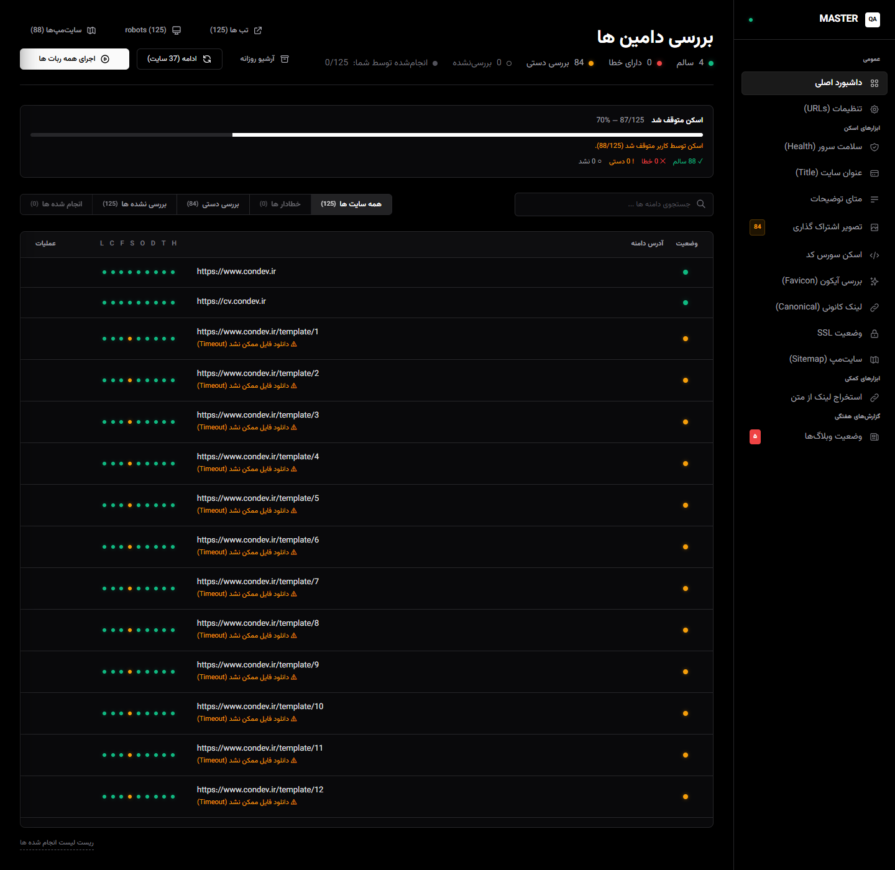
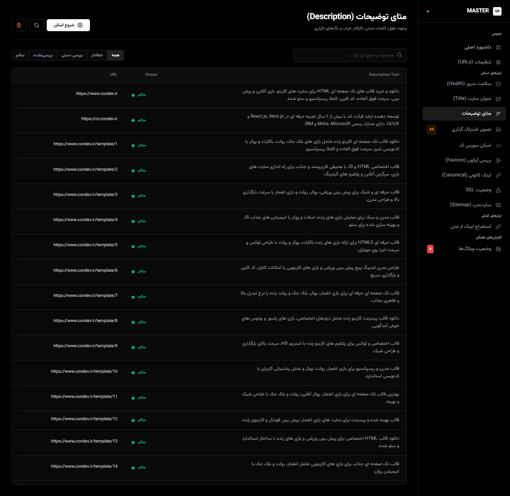
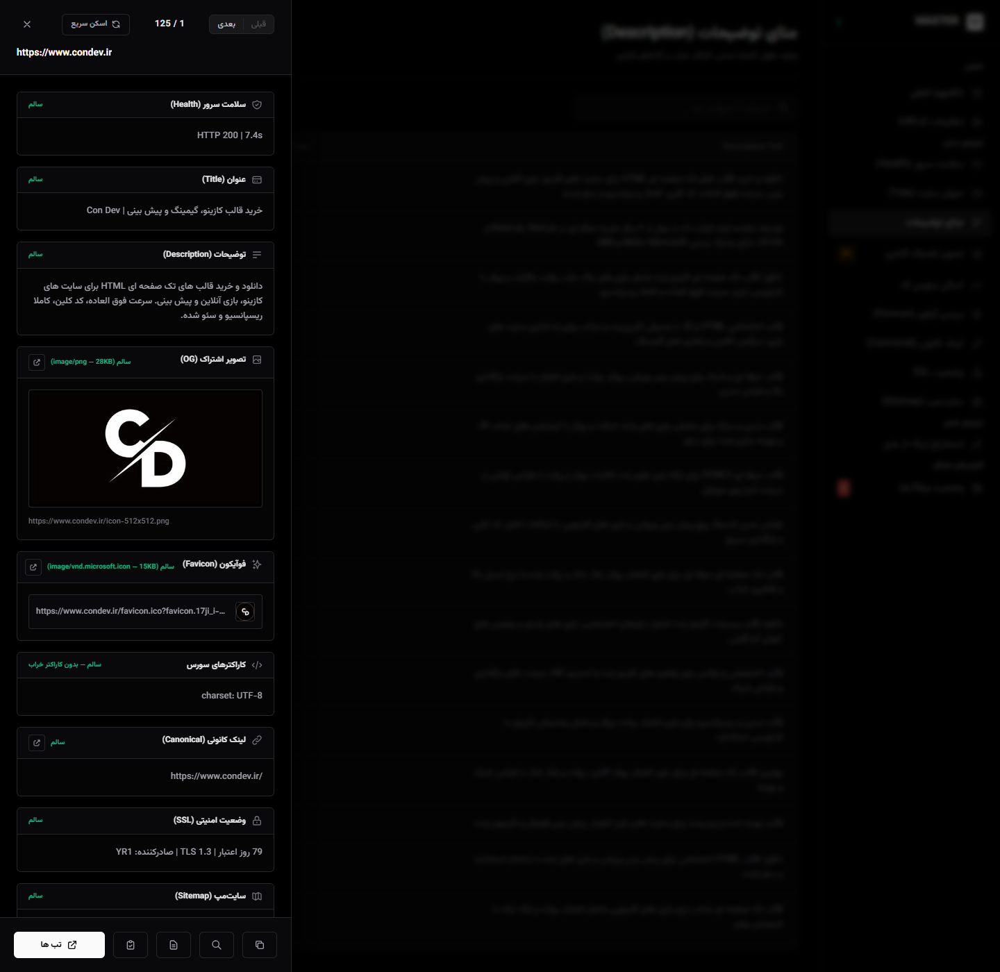
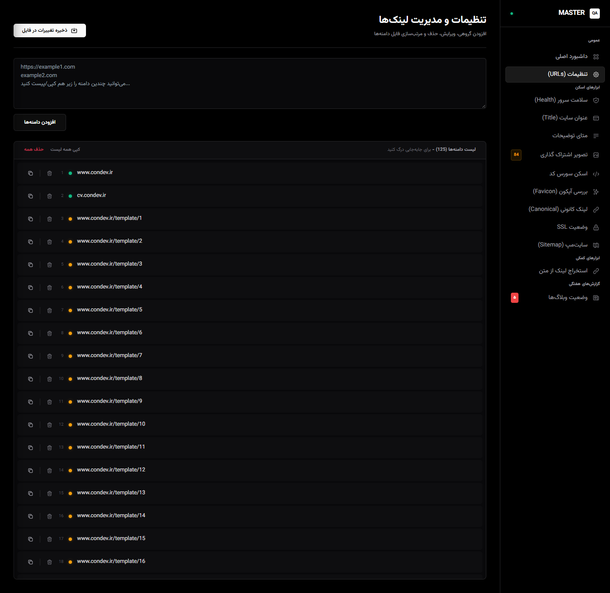
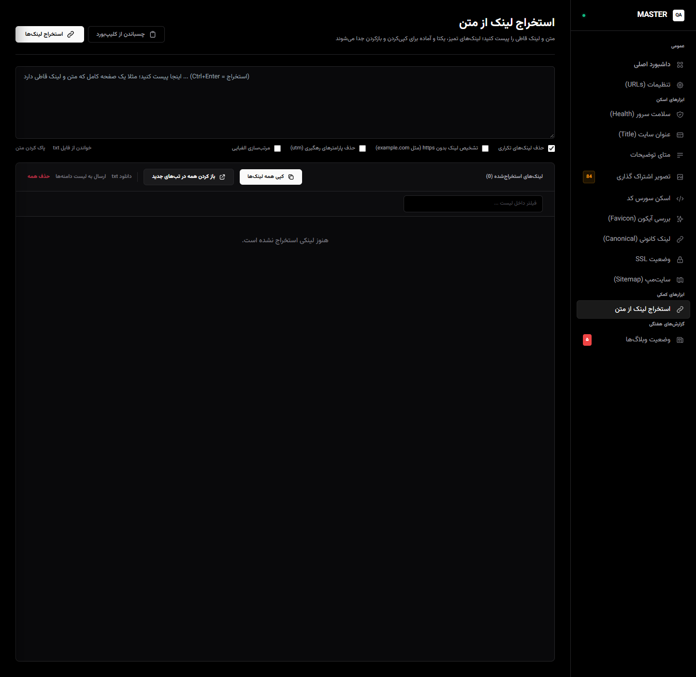
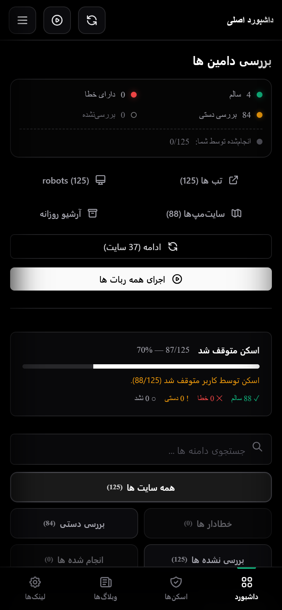

# 🧪 QA Audit

**QA Audit** – A self-hosted **QA & SEO audit panel** that scans a list of URLs with a real browser and reports what is actually broken, built with **Python, Flask, Playwright and Tailwind CSS**.
Designed with **a real RTL layout, live scan progress, per-URL detail cards and a full dark theme**, perfect for portfolio showcase.

> ⚡ **Portfolio-Level Project** – Showcasing Senior Front-End and automation expertise in **RTL panel design, headless-browser auditing and reusable component design**.

[](https://qa-audit-phi.vercel.app/)

---

## 🛠 Tech Stack


---

## ✨ Key Features

- 🖥 **Audit Panel** – A URL table with a per-check status dot on every row, live counters for OK / error / manual review / not checked, and quick openers for base URLs, robots and sitemaps
- ⚙️ **Live Scan Engine** – Every check runs in the background with a real progress bar, plus pause and continue, so a long run can be stopped and picked up later
- 🔍 **Nine Built-in Checks** – Server health, page title, meta description, canonical link, favicon, OG image, source encoding, SSL and sitemap
- 🗂 **Per-URL Detail Drawer** – Click a row to see every check for that URL in one place, including the live favicon and OG image previews
- 🖱 **Filterable Result Tables** – Each check has its own table with search, status colors and a filter bar (all / error / manual review / not checked / done)
- 🧰 **URL & Link Management** – Add domains in bulk, reorder, delete, filter and save the list straight back to `urls.txt`
- 🔗 **Extract Links from Text** – Paste a page's text or HTML, drop duplicates and `utm` tracking params, sort alphabetically and push the result into the URL list
- 🩺 **Manual Review, Not False Alarms** – Network-level problems on pages that still load are reported as "needs manual review" instead of hard errors
- 📊 **CSV Reports** – Every check writes its own report under `reports/`, so results stay readable outside the panel
- 📱 **Fully Responsive** – Off-canvas sidebar and a bottom navigation bar on mobile
- 🔒 **Optional Auth** – Basic auth switches on by itself when `QA_USER` and `QA_PASS` are set, so a tunneled panel stays private
- 🌙 **Persian, Dark and Single-File** – Full RTL layout with Vazirmatn typography, all in one `templates/index.html` with no build step

---

## 📸 Visual Preview

<div align="center">

### 🖥 Dashboard

*URL table with status dots, live counters and the scan controls.*



---

### 🔍 Check Results

*Per-check results table with status colors, tabs and search.*



---

### 🗂 URL Detail

*Every check for one URL inside a single drawer, with favicon and OG previews.*



---

### 🧰 Link Management

*Add domains in bulk, reorder, filter and save the list.*



---

### 🔗 Extract Links

*Pull clean, de-duplicated links out of pasted text.*



---

### 📱 Mobile

*Collapsed sidebar, stacked cards and bottom navigation, down to a 390px viewport.*



---

### 🔗 Live Demo

**[qa-audit-phi.vercel.app](https://qa-audit-phi.vercel.app/)**

</div>

---

## 🗂 Panel Views

| View | What it does |
| --- | --- |
| داشبورد اصلی | URL table with status dots, live counters and scan controls |
| تنظیمات (URLs) | URL list editor — add, reorder, delete, filter and save domains |
| سلامت سرور (Health) | Server health results per URL |
| عنوان سایت (Title) | Title tag results per URL |
| متای توضیحات (Description) | Meta description results per URL |
| تصویر اشتراک‌گذاری (OG Image) | Open Graph image results with previews |
| اسکن سورس کد (Source encoding) | Source encoding check results |
| بررسی آیکون (Favicon) | Favicon results with icon previews |
| لینک کانونی (Canonical) | Canonical link results |
| وضعیت SSL (SSL) | SSL status per URL |
| سایت‌مپ (Sitemap) | Sitemap check results |
| استخراج لینک از متن (Links) | Extract links from pasted text and push them into the URL list |

## 🧩 Project Structure

| Path | Description |
| --- | --- |
| `app.py` | Flask server, routes, scan orchestration and optional basic auth |
| `qa_core.py` | Shared core — paths, HTTP probes, browser page load, image download and report writers |
| `check_*.py` | One module per check: health, title, description, canonical, favicon, og_image, sitemap, source_encoding, ssl |
| `run_all.py` | Runs every check for every URL |
| `retry_single.py` | Re-runs the checks for one URL |
| `templates/index.html` | The whole panel UI — Tailwind, RTL layout and inline JavaScript |
| `link_lab.js` | Link handling helpers used by the panel |
| `urls.txt` | The URL list the panel reads and writes |
| `reports/` | One CSV per check plus the last run log |
| `archives/` | Daily backups of the project and older templates |
| `bat/windows.bat`, `bat/mobile.bat` | Local launcher and the mobile / tunnel launcher |

---

## ⚙️ How It Works

1. Put the URLs to audit in `urls.txt`, or add them from the URL settings view
2. Start the panel and open `http://127.0.0.1:5000`
3. Hit **اجرای همه ربات‌ها** to run every check for every URL
4. Watch the live progress bar — pause it any time and continue later
5. Click a row to open the detail drawer and see all checks for that URL
6. Open a check view to filter its results, or read the CSV under `reports/`

---

## 🚀 Setup

```bash
git clone https://github.com/condev-dev/QA-Audit.git
cd QA-Audit
pip install -r requirements.txt
playwright install chromium
python app.py
```

Then open `http://127.0.0.1:5000`. On Windows you can also just run `bat\windows.bat`; for phone access, `bat\mobile.bat` serves the panel on the network and opens a tunnel.

---

## 📄 License

**© ConDev** – All rights reserved.
